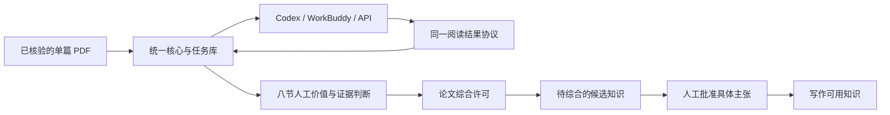

# Evidence Loop

默认保留人工评审门槛。项目可显式启用 `ai_review_with_optional_human`，通过独立八节 AI 核验报告继续批次与综合，同时保留用户随时介入的原评审页面；配置、命令和字段见 [自主核验模式](docs/ai-review.md)。`ai_verified` 与人工确认及人工批准字段分开保存。

**默认由人判断论文的价值、证据和引用许可；AI 帮助理解原文，核心负责流程。**

Evidence Loop 将单篇阅读、八节人工评审和可追溯知识输出放入同一个框架。Codex、WorkBuddy、其他 Agent 和 OpenAI 兼容 API 提交同一协议的结果。换宿主无需重建任务、复制状态机或依赖 Codex 子代理。支持 Windows 和 Linux，Python >=3.10。

## 使用

源码已随本仓收录在 `evidence-loop/`，不是 git submodule，无需单独 clone：

```bash
cd evidence-loop
python -m pip install ".[pdf]"
python -m evidence_loop --workspace ./workspace init
python -m evidence_loop --workspace ./workspace add-paper doi:example --pdf ./my-paper.pdf --context "我的研究问题与纳排标准"
```

`add-paper` 返回稳定 `job_id`。PDF 路径由使用者提供，应在进入阅读前完成题名/DOI/来源核验。框架不联网检索、不导入 Zotero。现有项目可把知识库目录直接用作 `--workspace`；原有 `review-jobs` 不需重建。

**Codex / WorkBuddy / 其他 Agent：**

```bash
python -m evidence_loop install-agent --target <宿主的skills目录>
python -m evidence_loop --workspace ./workspace issue <job_id> --reader workbuddy
```

将返回的 `request.json` 交给宿主模型。请求包含全文逐页文本、原文页图、阅读方法和结果格式。模型阅读后填写 JSON，再提交：

```bash
python -m evidence_loop --workspace ./workspace submit <job_id> <attempt_id> <result.json>
python -m evidence_loop --workspace ./workspace serve
```

打开 `serve` 输出的本地地址，完成八节判断并明确勾选论文综合许可；保存时状态自动推进。HTML 也可离线阅读、导出人工 JSON 后用 `import-review` 导入。AI 生成页面时许可默认关闭。

宿主非交互环境无法批准文件工具时，可让宿主模型只从标准输入读取全文、在标准输出返回 JSON，由框架完成全部文件写入。参照 [命令读取器配置](docs/command-reader.example.json)填写本机 CLI 路径，然后运行 `read-command <job_id> --config <本地配置.json>`。WorkBuddy 示例用 `--tools ""` 关闭工具；不需要放宽宿主的权限审查。该读取器同样使用统一结果协议，当前传递文本。

**DeepSeek / OpenAI 兼容 API：**把密钥置于环境变量 `DEEPSEEK_API_KEY`，无需放进配置或仓库。

```bash
python -m evidence_loop --workspace ./workspace read-api <job_id> --base-url https://api.deepseek.com --model <你账户可用的模型名>
```

模型名、接口地址、密钥变量、分块大小和输出预算均可配置。实现遵循 [DeepSeek 接口](https://api-docs.deepseek.com/)和 [JSON 输出约定](https://api-docs.deepseek.com/guides/json_mode/)。长文逐块读取全部页，再综合观察；超出预算、空回复、截断和格式错误会保持任务未完成。当前 API 接入使用文本；全部原文页图仍保留在人工页面，不能将文本阅读写成已视觉核验。

## 一套流程与权限

下面是默认 `human_required` 流程；自主模式在同一核心中增加独立的 `ai_verified` 分支。



八节覆盖：相关性与证据角色、问题与贡献、方法与数据、结果与证据、图表与公式、作者局限与人工批判、知识产物与迁移边界、论文关系与综合许可。方法强调原文陈述与 AI 推断分开、逐页锚定证据、负面判断有具体依据。领域目标由 `--context` 指定，不绑定某一综述主题。

整个 workspace 的阅读背景也可保存在 `review-context.md`，随任务一起迁移。兼容已有 `review-project.json` 的核心问题、研究论点、知识产物与人工门控字段，不读取其中的个人配置或密钥。

`review-jobs/jobs/*/job.json` 是唯一状态源。派生索引可重建。每批最多 3 篇，默认在人工终态前不能开下一批；自主模式也接受有效的 `ai_verified`。文件锁串行化共享写入；执行者只写自己的 attempt 目录。`issue --handoff` 生成新执行凭据，旧结果不得覆盖。宿主技能只是入口，同一框架也可在宿主外直接运行。

人工许可绑定 PDF、笔记、结构化结果、原文页图和 HTML 的哈希。变动会使许可失效；`revoke` 明确撤销许可。默认模式下 `knowledge` 只导出人工允许的论文候选，`knowledge --approved-only` 只导出人工批准的具体主张。自主模式同时导出独立标识的 AI 核验主张，具体字段见 [自主核验模式](docs/ai-review.md)。模型无法通过阅读结果授予人工许可。

需要补读或修订时，显式 `reopen <job_id> [--pdf <已核验的新版本>]`；旧任务快照与人工记录保留，新阅读按当前配置重新核验。修订当前批次保留其批次归属。

迁移时带走本地 workspace，另外迁移合法可用的 PDF；任务内部路径会重定位。外部 PDF 使用 `relocate-source <job_id> <新路径>` 重新绑定相同哈希文件。密钥在新环境单独配置。协议详见 [docs/protocol.md](docs/protocol.md)。

## 开发与发布

```bash
python -m pip install ".[pdf,dev]"
python -m pytest -q
python -m build
python scripts/audit_release.py
```

测试使用运行时生成的模拟 PDF、本地 HTTP 模拟 API 和模拟人工输入；不读取私人文库，不产生模型账单。覆盖跨宿主协议、交接、并发抢占、人工保存、哈希失效、迁移、批次门控与 API 全文分块。真实 DeepSeek 调用需自行配置账户密钥，发布验证不冒充真实模型测试。

MIT 授权适用于框架自有代码；第三方依赖见 [THIRD_PARTY_NOTICES.md](THIRD_PARTY_NOTICES.md)。运行数据、论文、密钥与宿主个人配置均排除在发行包外，发布范围见[仓库白名单](../docs/CONTRACTS.md#9-仓库白名单)。

English: Evidence Loop is a host-neutral human judgment / AI-assisted reading framework. One PDF per job, one state store, replaceable native-agent and OpenAI-compatible readers, offline eight-section review pages, explicit human citation permission and source-bound provenance. See [the protocol](docs/protocol.md) for integration.
